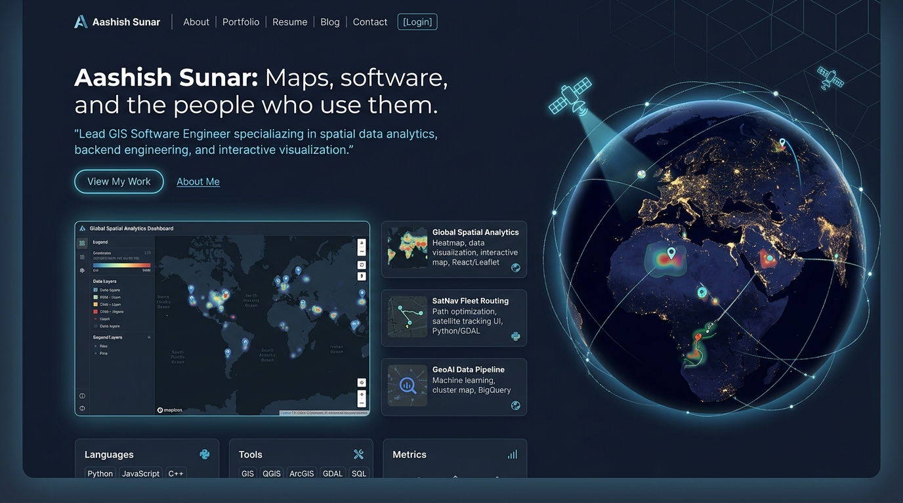

# Aashish Sunar — Esri & GIS Software Portfolio

**[Try the live demo →](https://aashisho1o1.github.io/esri-portfolio/)**

[](https://aashisho1o1.github.io/esri-portfolio/)

> *"I build software for people who are not GIS specialists: the office assistant who has never opened a mapping tool, or the student who only wants to know which hospital is closest. I would like to keep doing that at Esri."*

---

## 🌍 About

**Aashish Sunar**  
📍 Claremont, California (34.10° N, 117.71° W — ~30 miles from Esri HQ in Redlands)  
✉️ [aashishsunar.01@gmail.com](mailto:aashishsunar.01@gmail.com) | 💼 [LinkedIn](https://www.linkedin.com/in/aashish-sunar/) | 🐙 [GitHub](https://github.com/Aashisho1o1) | 📄 [Resume (PDF)](resume.pdf)

Candidate for **ArcGIS Product Engineering** and **Software Development Engineer (SDE) Intern** roles at Esri.

---

## 🚀 Featured Projects & Live Demos

| Project | Tech Stack | Live Demo | Source Code |
| :--- | :--- | :--- | :--- |
| **Hazard Proximity MCP Server** | TypeScript, MCP SDK, NASA EONET, ArcGIS Living Atlas | [Explore Live Map](https://aashisho1o1.github.io/geoassist-mcp/) | [GitHub Repo](https://github.com/Aashisho1o1/geoassist-mcp) |
| **GeoAssist — Natural Language to Spatial Queries** | React, TypeScript, ArcGIS Map Components, Calcite Design System | [Interactive Demo](https://aashisho1o1.github.io/GeoAssist/) | [GitHub Repo](https://github.com/Aashisho1o1/GeoAssist) |
| **Alumni Spatial Distribution Tool** | Python, Streamlit, Folium/Leaflet, Pandas | [Streamlit App](https://8gkea33ouexurck54ybeah.streamlit.app/) | [GitHub Repo](https://github.com/Aashisho1o1/ADT) |
| **BlueHabit** | Spatial Data Analytics, Environmental Tracking | [Devpost Project](https://devpost.com/software/bluehabit) | — |
| **Interactive 3D Night Globe & ArcGIS Fly-Through** | ArcGIS Maps SDK for JS, Globe.gl, NASA Earth at Night | [Launch Portfolio](https://aashisho1o1.github.io/esri-portfolio/) | *This Repository* |

---

## 🛠️ Technical Skills

- **Languages:** Python, Java, JavaScript, TypeScript, C, C++, SQL, HTML5/CSS3
- **GIS & Mapping:** ArcGIS Maps SDK for JavaScript, ArcGIS REST APIs, Living Atlas, Calcite Design System, Leaflet, GeoJSON, GDAL, OpenStreetMap
- **Web & Frameworks:** React, Next.js, Node.js, Streamlit, Fastify, Playwright
- **Data & Cloud:** PostgreSQL, BigQuery, REST APIs, MCP (Model Context Protocol), NASA EONET API

---

## 📁 Repository Structure

```text
├── docs/                      # GitHub Pages deployment directory
│   ├── index.html             # Interactive portfolio (3D globe + ArcGIS SDK)
│   ├── assets/demo.png        # Portfolio preview banner
│   ├── resume.pdf             # Web-accessible PDF resume
│   └── *.pdf                  # Cover letters & resumes
├── assets/
│   └── demo.png               # High-resolution README preview image
├── Aashish_Sunar_Resume_Esri_ArcGISProductEngineering.pdf
├── Aashish_Sunar_Resume_Esri_SDEIntern.pdf
├── Aashish_Sunar_CoverLetter_Esri_ArcGISProductEngineering.pdf
├── Aashish_Sunar_CoverLetter_Esri_SDEIntern.pdf
├── index.html                 # Root portfolio copy
├── resume.pdf                 # Symlinked / copied default resume
└── README.md                  # Project overview & documentation
```

---

## ⚙️ Enabling GitHub Pages

To serve the live interactive portfolio from this repository:

1. Go to your repository on GitHub: [`https://github.com/Aashisho1o1/esri-portfolio`](https://github.com/Aashisho1o1/esri-portfolio)
2. Click **Settings** → **Pages** (in the left sidebar).
3. Under **Build and deployment** → **Branch**:
   - Select `main`.
   - In the folder dropdown, choose `/docs`.
4. Click **Save**.
5. Within ~60 seconds, your site will be live at:  
   👉 **[https://aashisho1o1.github.io/esri-portfolio/](https://aashisho1o1.github.io/esri-portfolio/)**
